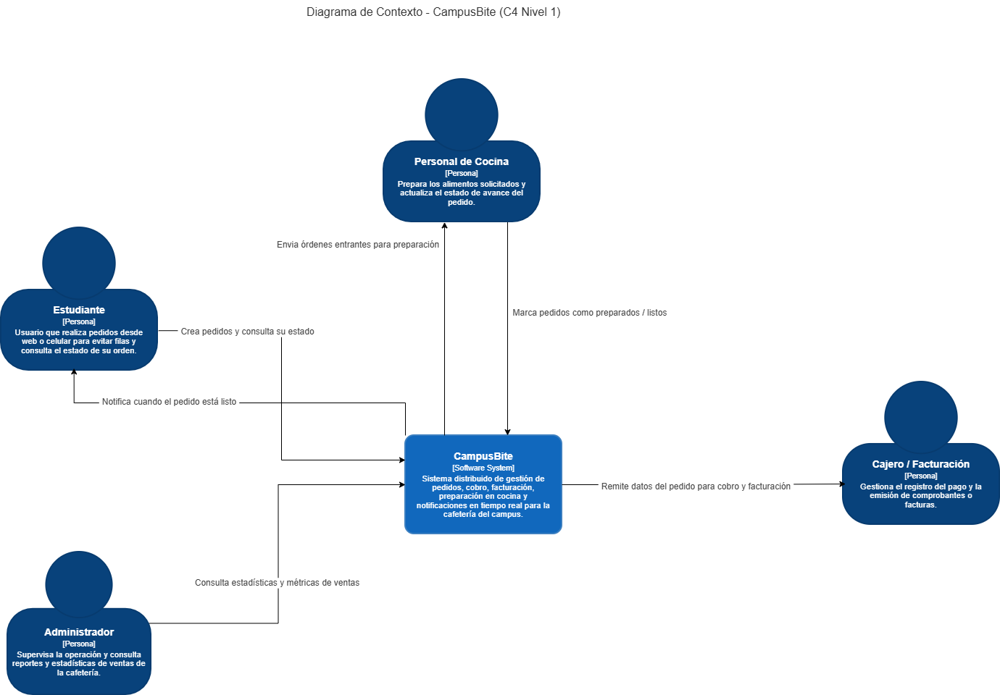

# Diagrama de Contexto – Sistema del Campus

## Descripción General
El presente diagrama muestra la vista de contexto del sistema distribuido del campus, delimitando su alcance funcional y sus interacciones con los usuarios externos de la cafetería del campus, sin entrar en detalles de implementación interna o protocolos de comunicación.

## Actores Externos

* **Estudiante:** Realiza pedidos desde la aplicación web o móvil para evitar filas, consulta el estado de su orden y recibe una notificación en tiempo real cuando está lista para retirar.
* **Personal de Cocina:** Visualiza las órdenes entrantes para su preparación y actualiza el estado de avance del pedido hasta marcarlo como listo.
* **Cajero / Facturación:** Recibe la información del pedido para gestionar el cobro y emitir el comprobante o factura correspondiente.
* **Administrador:** Consulta métricas y reportes consolidados de ventas para supervisar la operación de la cafetería.