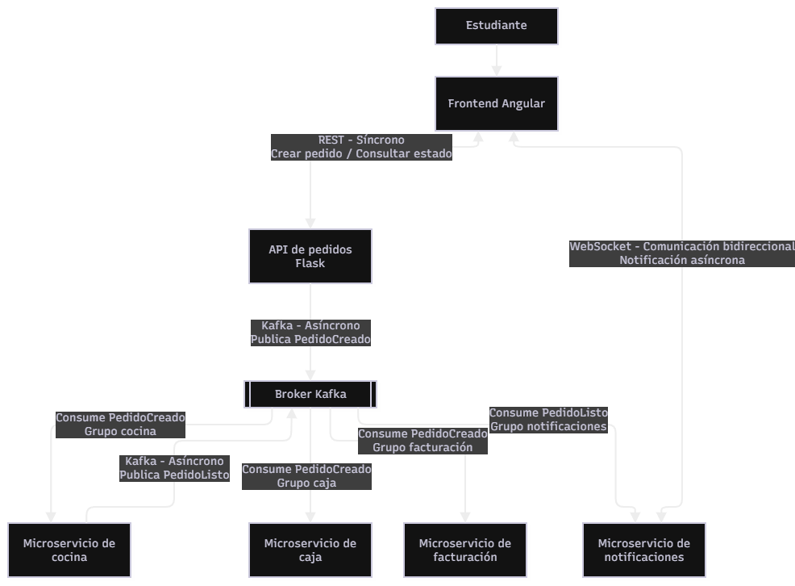

# Mapa de microservicios

## 1. Descripción general

El sistema de pedidos de la cafetería universitaria se organiza mediante una arquitectura distribuida basada en microservicios. Cada servicio cumple una responsabilidad específica y se comunica con los demás mediante mecanismos de comunicación definidos según las necesidades del sistema.

La arquitectura utiliza tres mecanismos de comunicación: REST, Kafka y WebSockets. REST permite la comunicación síncrona entre el frontend y la API de pedidos; Kafka permite la comunicación asíncrona mediante eventos entre los servicios internos; y WebSockets permite enviar notificaciones en tiempo real al estudiante.

## 2. Componentes de la arquitectura

- **Frontend:** desarrollado en Angular. Proporciona la interfaz mediante la cual el estudiante registra pedidos y consulta su estado.
- **API de pedidos:** recibe las solicitudes del frontend, valida y registra los pedidos, permite consultar su estado y publica eventos en Kafka.
- **Servicio de cocina:** consume los eventos de pedidos recibidos y gestiona su preparación. Cuando un pedido está listo, publica el evento correspondiente.
- **Servicio de caja:** consume los eventos de pedidos y gestiona la información relacionada con el proceso de pago.
- **Servicio de facturación:** consume los eventos necesarios para gestionar la información de facturación.
- **Servicio de notificaciones:** consume los eventos de pedidos listos y envía notificaciones al frontend mediante WebSockets.
- **Servicio de estadísticas:** consume eventos para recopilar información y generar reportes administrativos.
- **Broker Kafka:** permite transmitir eventos entre los servicios mediante un modelo de publicación y suscripción.

## 3. Mecanismos de comunicación

### 3.1 REST

Se utiliza para la comunicación entre el frontend Angular y la API de pedidos. Permite registrar nuevos pedidos y consultar su estado mediante solicitudes HTTP.

Es un mecanismo síncrono porque el cliente realiza una solicitud y espera la respuesta del servidor.

### 3.2 Apache Kafka

Se utiliza para la comunicación asíncrona entre la API de pedidos y los microservicios internos.

Cuando se registra un pedido, la API publica el evento `PedidoCreado`. Los servicios de cocina, caja, facturación y estadísticas consumen este evento mediante grupos de consumidores independientes.

Cuando cocina termina de preparar un pedido, publica el evento `PedidoListo`, que posteriormente es consumido por el servicio de notificaciones.

### 3.3 WebSockets

Se utilizan para establecer una comunicación bidireccional entre el servicio de notificaciones y el frontend.

Cuando el servicio de notificaciones recibe el evento `PedidoListo` desde Kafka, envía un mensaje al estudiante para informarle que su pedido está listo, sin necesidad de actualizar manualmente la página.

## 4. Flujo general de comunicación

1. El estudiante registra un pedido desde el frontend Angular.
2. El frontend envía una solicitud REST a la API de pedidos.
3. La API valida y registra el pedido, y publica el evento `PedidoCreado` en Kafka.
4. Los servicios de cocina, caja, facturación y estadísticas consumen el evento según sus responsabilidades.
5. Cuando cocina termina la preparación, publica el evento `PedidoListo` en Kafka.
6. El servicio de notificaciones consume el evento y envía una notificación al frontend mediante WebSockets.
7. El estudiante recibe la notificación y puede consultar el estado actualizado mediante REST.

## 5. Consideraciones de la arquitectura

- Los mecanismos de comunicación se integran dentro de un mismo flujo de procesamiento de pedidos.
- Kafka permite desacoplar los servicios internos y procesar eventos de manera asíncrona.
- Cada servicio consumidor utiliza un grupo de consumidores independiente cuando necesita recibir los mismos eventos.
- WebSockets permite informar al estudiante sobre cambios importantes sin realizar solicitudes repetitivas.
- La API permite consultar el estado persistente del pedido, incluso cuando el estudiante pierde temporalmente la conexión.

## 6. Diagrama de arquitectura

El siguiente diagrama representa los componentes del sistema, sus responsabilidades y los mecanismos de comunicación utilizados.

